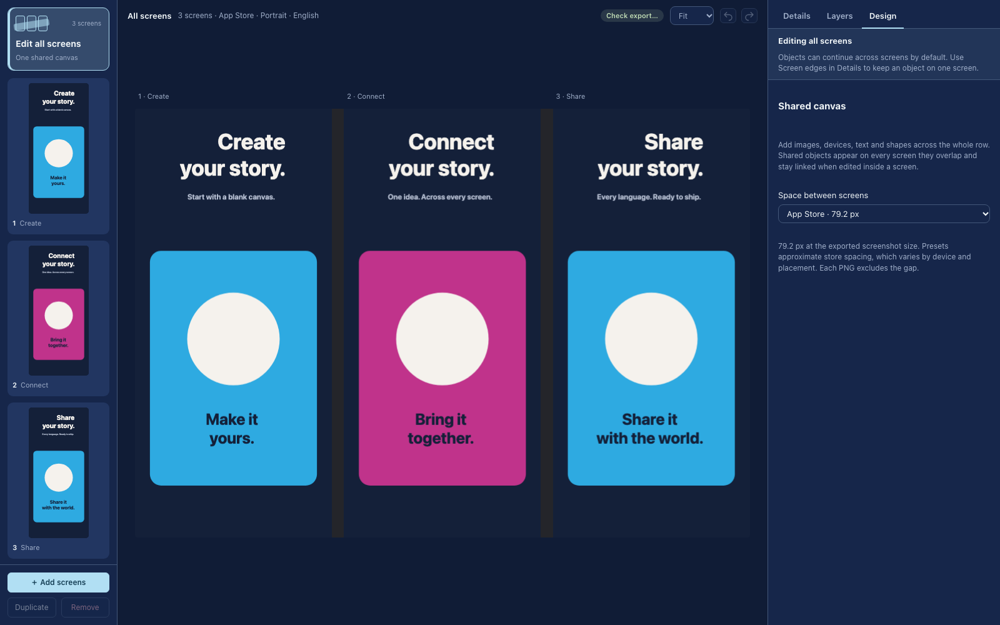

<p align="center">
  <picture>
    <source media="(prefers-color-scheme: dark)" srcset="docs/assets/github-logo-dark.svg">
    
  </picture>
</p>

<h1 align="center">Screenshot Studio</h1>

<p align="center">
  <b>Turn your app screenshots into a story.</b><br>
  Editable designs, connected screens, device illustrations and multilingual copy.<br>
  An offline Mac app. Open source under MIT. Your projects stay on your Mac.
</p>

<p align="center">
  <a href="https://github.com/GioPalusa/ScreenShotStudio/actions/workflows/ci.yml"></a>
  <a href="https://github.com/GioPalusa/ScreenShotStudio/actions/workflows/codeql.yml"></a>
  
  
</p>

<p align="center">
  <a href="https://github.com/GioPalusa/ScreenShotStudio/releases/latest"><b>Download for Mac</b></a> ·
  <a href="https://github.com/GioPalusa/ScreenShotStudio/discussions">Join the community</a> ·
  <a href="CONTRIBUTING.md">Contribute</a>
</p>



*The real editor with an original demo composition. All artwork in this example was created for this project.*

> [!NOTE]
> Build this with us. Designers, translators, developers and people shipping their first app are welcome. Share designs and ideas in [Discussions](https://github.com/GioPalusa/ScreenShotStudio/discussions), or tell us what needs improving in [Issues](https://github.com/GioPalusa/ScreenShotStudio/issues).

[Features](#features) · [Downloads](#downloads) · [Get started](#get-started) · [Under the hood](#under-the-hood) · [Contributing](#contributing) · [Documentation](#documentation)

## Features

### One story across your screens

Work on an entire screenshot row in **Edit all screens**, or refine one screen at a time. Text, images and shapes can continue across screen edges. Choose App Store, Google Play or custom spacing; exported screenshots crop each screen without the preview gaps.

### Keep every design editable

Arrange text, screenshots, shapes and artwork as layers. Move, resize, rotate and align objects on the canvas. Save reusable designs, duplicate screens, and undo changes. Device illustrations and imported frames are separate from the output canvas, so a design can adapt to different store formats.

### Every language in one project

Edit translations alongside the design, preview right-to-left layouts, and export or import review CSVs. Each language keeps its own copy and review status. One portable project produces every language × canvas × screen.

### Export with confidence

Preflight checks identify missing captures, overflow and other issues before export. Final CLI exports can require all checks to pass. Outputs are RGB PNGs at the exact configured dimensions, with a manifest and upload guide.

### Your work stays yours

Projects are ordinary portable `.sss` directory packages. Autosave uses atomic writes, revision checks and recovery drafts. The desktop app runs offline through a private protocol, with no local web server or required account. Optional translation services require your own provider configuration.

## Downloads

| Platform | Download | Requirements |
| --- | --- | --- |
| macOS · Apple silicon | [Latest release](https://github.com/GioPalusa/ScreenShotStudio/releases/latest) | macOS 13 or newer; Developer ID signed and notarized by Apple |

Unzip the release and move **Screenshot Studio.app** into **Applications**. Checksums are attached to each release. Intel Mac, Windows and Linux binaries are not currently published.

Version 0.2.6 introduces native updates. Install it manually once if you have an earlier build. Future official releases can download through **Screenshot Studio → Check for Updates…**; installation waits for acknowledged project saves.

## Get started

1. Create a project and choose a palette and store canvas.
2. Add your screenshots and select a device illustration or import your own frames.
3. Pick a design, edit the layers and translate your copy.
4. Preview every screen and export your PNGs.

See the [user guide](docs/user-guide.md) for the full workflow.

### Run from source

Requires Node.js 22.12+ and npm. The desktop app is currently developed and packaged on macOS.

```sh
git clone https://github.com/GioPalusa/ScreenShotStudio.git
cd ScreenShotStudio
npm ci
npm run desktop
```

```sh
npm test             # module, storage, document and updater tests
npm run test:render  # real Chrome UI and export integration
npm run package      # ad-hoc signed Mac developer build
```

Renderer tests require Chrome; set `CHROME_PATH` if it is installed elsewhere. An ad-hoc development build is separate from the signed and notarized official release.

## Under the hood

- Plain JavaScript ES modules, with no frontend build step.
- Pure document, layout and edit modules shared by the renderer and Node tests.
- Filesystem services in `host/`; native menus, documents and updates in `desktop/`.
- Electron desktop shell using `studio://local`, with no listening HTTP server.
- Synthetic fixtures for tests; private user projects and Apple artwork are excluded.

Pull requests run code tests, real renderer/export tests, Mac packaging, a public source check and CodeQL security analysis. Dependabot checks npm dependencies and GitHub Actions weekly. See [contribution guidelines](CONTRIBUTING.md).

## Contributing

Start with [CONTRIBUTING.md](CONTRIBUTING.md). Bug reports, translations, design improvements, documentation and code contributions are welcome. Discuss larger changes before implementation so we can agree on the scope.

This is an early public release. Please include your macOS version and steps to reproduce when reporting issues. Automatic installation of a newer published version will receive end-to-end verification when a subsequent release is available.

## Documentation

- [User guide](docs/user-guide.md)
- [Building, signing and publishing releases](docs/releases.md)
- [Security policy](SECURITY.md)
- [Third-party notices and artwork](THIRD_PARTY_NOTICES.md)

## License

[MIT](LICENSE) © Giovanni Palusa. Apple device artwork is not bundled or covered by this project's license. Import your own assets under their applicable terms.
